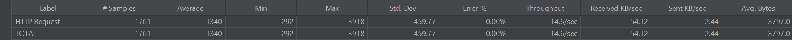
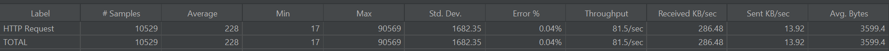
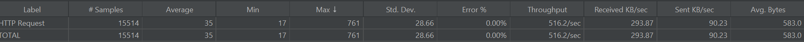
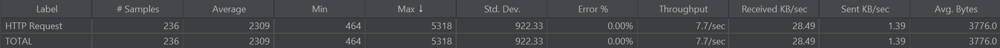
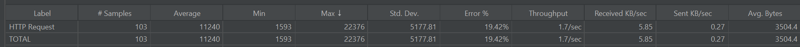
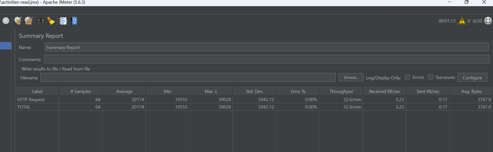

# CampusHub

面向校园场景的综合交易与生活服务平台。第一版以校园二手交易为核心，同时保留校园活动和问答社区业务，整体采用 Spring Cloud 微服务架构。

## 目录

- `backend/`：Java 微服务后端
- `frontend/campus-hub-web/`：统一 Vue 单页前端
- `database/`：按服务隔离的 MySQL 初始化脚本

## 后端服务

- `campus-gateway`：统一网关，端口 8080
- `campus-user-service`：用户与地址，端口 8081
- `campus-secondhand-service`：校园二手物品与分类，端口 8082
- `campus-cart-service`：购物车，端口 8083
- `campus-order-service`：交易订单，端口 8084
- `campus-payment-service`：支付与支付事件，端口 8085
- `campus-activity-service`：活动、报名、签到，端口 8090
- `campus-community-service`：问答、回答、评论、点赞、关注、标签，端口 8091
- `campus-api`：服务间接口和 DTO
- `campus-common`：公共响应、异常、认证和基础配置

`zg-ai` / Spring AI 不在当前项目中。后续智能能力计划独立使用 Python Agent 接入。

## 数据库边界

每个业务服务使用独立数据库：

```text
campus-user-service       -> campushub_user
campus-activity-service   -> campushub_activity
campus-community-service  -> campushub_community
campus-secondhand-service -> campushub_secondhand
campus-cart-service       -> campushub_cart
campus-order-service      -> campushub_order
campus-payment-service    -> campushub_payment
```

服务之间通过业务 ID、HTTP/Feign 或消息进行协作，不跨库 JOIN，也不共享数据库表。

## 第一次测试

2026-11-06，用 JMeter 对二手商品模块的读接口做并发压测。压测机在本地，服务部署在腾讯云（4 核 4G、3 Mbps 公网带宽），20 并发，商品表 103 万行。

| 接口 | QPS | 平均响应 | 空载 | 瓶颈 |
|---|---|---|---|---|
| `GET /api/items/{id}` | **508** | 35 ms | 4.5 ms | 公网 3 Mbps 带宽 |
| `GET /api/items/hot` | **77** | 221 ms | 9.6 ms | 同上 |
| `GET /api/items` | **15.5** | 1093 ms | 220 ms | `COUNT(*)` 扫全表 + Hikari 5 连接 |
| `GET /api/items?categoryId=1` | **7.6** | 2309 ms | 430 ms | 缺联合索引，走 index_merge |
| `GET /api/items?sort=priceAsc` | **1.7** | 11240 ms | 1593 ms | 无 price 索引，filesort |
| `GET /api/items?keyword=教材` | **0.96** | 19844 ms | 3981 ms | `LIKE '%x%'` 索引失效 |

**默认列表 `GET /api/items`**



**热门商品 `GET /api/items/hot`**



**商品详情 `GET /api/items/{id}`**



**分类筛选 `GET /api/items?categoryId=1`**



**价格排序 `GET /api/items?sort=priceAsc`**



**关键词搜索 `GET /api/items?keyword=教材`**



### 不足

- **分页带 `COUNT(*)`**：103 万行表上每次 200 ms，5 个 Hikari 连接把吞吐压在 15 QPS
- **价格排序无索引**：`ORDER BY price` 触发 filesort 扫全表，单次 1.6 秒
- **分类筛选缺 `(status, category_id)` 联合索引**：`index_merge intersect` 比全表扫描更慢（430 ms vs 220 ms）
- **搜索用 `LIKE '%x%'`**：前导通配符，索引完全失效，单次 4 秒
- **压测方法有偏差**：JMeter 跑在 GUI 模式、压测机与被测机跨公网、只有 20 并发单档，缺少 P90/P99，绝对值偏低

### 并发写：报名抢名额

50 个不同用户并发抢 1 个名额（`POST /api/signups`），验证不超卖。

| 指标 | 值 |
|---|---|
| 吞吐 | **9.9 QPS** |
| 平均响应 | 369 ms |
| 最小 / 最大 | 89 / 1631 ms |
| 结果分布 | 1 个成功，49 个「名额已满」 |
| 一致性校验 | `tb_signup` 1 条、`remain_quota` 0、Redis `stock` 0 ✅ |

**不足**

- **超卖完全靠 MySQL 行锁兜底**：`UPDATE ... WHERE remain_quota > 0` 让 50 个请求串行排队，单次锁持有 5~7 ms，最后一个要等 250 ms
- **Redis 挡流在抢购瞬间不起作用**：`signup.lua` 只读、不扣减，并发请求都读到 `stock = 1`，全部放行，压力原样落到 DB
- **事务包住了 Redis 回写**：行锁从 `takeQuota` 一直持有到方法返回，中间还夹着 INSERT 明细和两次 Redis 调用（`DECR` + `SADD`）
- **Hikari 连接池只有 5 个**：50 并发下连接排队约 70 ms
- **369 ms 是四段排队叠加**：公网往返 48 ms + 连接排队 70 ms + 行锁排队 150 ms + 事务内 SQL/Redis 约 7 ms


