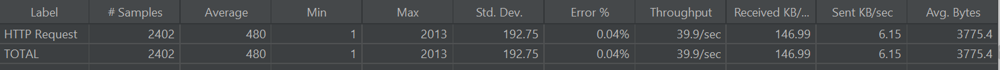
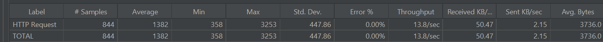
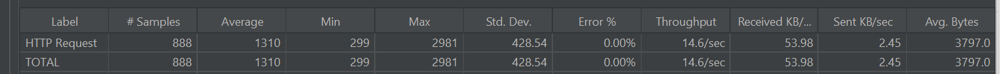
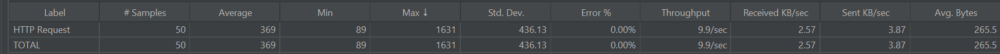
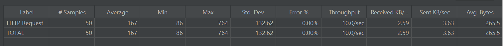

# CampusHub

面向校园场景的综合交易与生活服务平台。第一版以校园二手交易为核心，同时保留校园活动和问答社区业务，整体采用 Spring Cloud 微服务架构。

## 目录

- `backend/`：Java 微服务后端
- `frontend/campus-hub-web/`：统一 Vue 单页前端
- `database/`：按服务隔离的 MySQL 初始化脚本

## 后端服务

- `campus-gateway`：统一网关，端口 8080
- `campus-user-service`：用户与地址，端口 8081
- `campus-secondhand-service`：校园二手物品与分类，端口 8082
- `campus-cart-service`：购物车，端口 8083
- `campus-order-service`：交易订单，端口 8084
- `campus-payment-service`：支付与支付事件，端口 8085
- `campus-activity-service`：活动、报名、签到，端口 8090
- `campus-community-service`：问答、回答、评论、点赞、关注、标签，端口 8091
- `campus-api`：服务间接口和 DTO
- `campus-common`：公共响应、异常、认证和基础配置

`zg-ai` / Spring AI 不在当前项目中。后续智能能力计划独立使用 Python Agent 接入。

## 数据库边界

每个业务服务使用独立数据库：

```text
campushub_user
campushub_activity
campushub_community
campushub_secondhand
campushub_cart
campushub_order
campushub_payment
```


## 第一次测试

2026-11-06 用 JMeter 做并发压测。压测机在本地，服务部署在腾讯云（4 核 4G、3 Mbps 公网带宽），商品表 103 万行。

### 读接口

20 并发，六种查询形态：

| 接口                           | QPS      | 平均响应 | 空载    | 瓶颈                              |
| ------------------------------ | -------- | -------- | ------- | --------------------------------- |
| `GET /api/items/{id}`          | **508**  | 35 ms    | 4.5 ms  | 公网 3 Mbps 带宽                  |
| `GET /api/items/hot`           | **77**   | 221 ms   | 9.6 ms  | 同上                              |
| `GET /api/items`               | **15.5** | 1093 ms  | 220 ms  | `COUNT(*)` 扫全表 + Hikari 5 连接 |
| `GET /api/items?categoryId=1`  | **7.6**  | 2309 ms  | 430 ms  | 缺联合索引，走 index_merge        |
| `GET /api/items?sort=priceAsc` | **1.7**  | 11240 ms | 1593 ms | 无 price 索引，filesort           |
| `GET /api/items?keyword=教材`  | **0.96** | 19844 ms | 3981 ms | `LIKE '%x%'` 索引失效             |

**默认列表 `GET /api/items`**


**热门商品 `GET /api/items/hot`**


**商品详情 `GET /api/items/{id}`**


**分类筛选 `GET /api/items?categoryId=1`**


**价格排序 `GET /api/items?sort=priceAsc`**


**关键词搜索 `GET /api/items?keyword=教材`**


**不足**

- **分页带 `COUNT(*)`**：103 万行表上每次 200 ms，5 个 Hikari 连接把吞吐压在 15 QPS
- **价格排序无索引**：`ORDER BY price` 触发 filesort 扫全表，单次 1.6 秒
- **分类筛选缺 `(status, category_id)` 联合索引**：`index_merge intersect` 比全表扫描更慢（430 ms vs 220 ms）
- **搜索用 `LIKE '%x%'`**：前导通配符，索引完全失效，单次 4 秒

### 优化后复测

针对上面四条不足做了索引和查询改造，同一套压测参数（20 线程 / 120 秒）复测：

| 接口       | 优化前            | 优化后                 | 手段                                                                                    |
| ---------- | ----------------- | ---------------------- | --------------------------------------------------------------------------------------- |
| 分类筛选   | 7.6 QPS / 2400 ms | **39.9 QPS / 480 ms**  | 加 `(category_id, status, id)` 联合索引，消掉 `index_merge`                             |
| 价格排序   | 1.7 QPS / 11.2 s  | **13.8 QPS / 1382 ms** | 加 `(status, price, id)`；`priceDesc` 的 tie-break 改成 `id DESC`，一条索引服务两个方向 |
| 关键词搜索 | 0.96 QPS / 20 s   | **14.6 QPS / 1310 ms** | `LIKE '%x%'` 改前缀 `LIKE 'x%'`，配 `(status, name)` 索引                               |

**优化后：分类筛选 39.9 QPS**



**优化后：价格排序 13.8 QPS**



**优化后：关键词搜索 14.6 QPS**



**剩下的耗时几乎全是 `COUNT(*)`**，与排序无关：

```
分类筛选  count 数 24 万行  → 66 ms
价格排序  count 数 103 万行 → 220 ms
关键词    count 数 26 万行  → 194 ms
```

索引从 5 条增加到 8 条，三次 DDL 全部 `ALGORITHM=INPLACE, LOCK=NONE`，耗时 6s / 4s / 9s，不阻塞读写。

> 搜索改前缀后语义变窄：只能从商品名开头匹配，搜「高数」找不到「同济高数教材」。

### 并发写：报名抢名额

50 个不同用户并发抢 1 个名额（`POST /api/signups`），验证不超卖。

**改造前**：Redis 的 Lua 只读不写，抢购瞬间所有请求都被放行，压力全部落在 MySQL 行锁上。

| 指标              | 改造前                                              |
| ----------------- | --------------------------------------------------- |
| 平均响应          | 369 ms                                              |
| 最小 / 最大       | 89 / 1631 ms                                        |
| 打到 MySQL 的 SQL | 约 101 条（50 次查活动 + 50 次更新库存 + 1 次插入） |
| 结果              | 1 个成功，49 个「名额已满」                         |



**改造：Redis 原子预扣**

`signup.lua` 从「只读判断」改成「校验 + 扣名额 + 记临时占用」：

```lua
if not stock then return 3 end                                   -- 未预热，交给 Java 从 DB 重建
if redis.call('sismember', users, userId) == 1 then return 2 end -- 已报名
if tonumber(holdScore) > now then return 4 end                   -- 处理中（防重复点击）
if tonumber(stock) <= 0 then return 1 end                        -- 名额已满
redis.call('decr', stock)                                        -- 扣名额
redis.call('sadd', users, userId)                                -- 记名单
redis.call('zadd', hold, now + 30000, userId)                    -- 记临时占用
return 0
```

只有返回 0 的请求才进入 MySQL 事务，其余在 Redis 这一层就被挡回。DB 仍然是唯一裁决——`takeQuota` 的 `WHERE remain_quota > 0` 保留着，Redis 与 DB 漂移时以 DB 为准。

配套三项：

| 机制         | 作用                                                                                 |
| ------------ | ------------------------------------------------------------------------------------ |
| 同步补偿     | 落库失败时 `INCR` 名额、`SREM` 名单、`ZREM` 占用；唯一索引冲突时保留名单             |
| 定时对账     | 每 5 分钟比对 Redis `stock` 与 DB `remain_quota`，不一致以 DB 为准覆盖并 `log.error` |
| 过期占用清理 | 对账时顺带 `ZREMRANGEBYSCORE`，避免 ZSet 无限增长                                    |

**改造后（50 人抢 1 个名额）**

| 指标       | 改造前            | 改造后                                 |
| ---------- | ----------------- | -------------------------------------- |
| 平均响应   | 369 ms            | **167 ms**                             |
| 最大响应   | 1631 ms           | **764 ms**                             |
| 最小响应   | 89 ms             | 86 ms（≈ 一次公网 RTT）                |
| 一致性校验 | 1 条记录 / 余量 0 | 1 条记录 / 余量 0 ✅                   |
| Redis 状态 | stock 0           | stock 0、users 1、hold 0（提交后已清） |

最小响应 86 ms 等于一次公网往返，说明被拒的 49 个请求只花了「发出 → Redis 拒绝 → 返回」，全程没有碰 MySQL。




